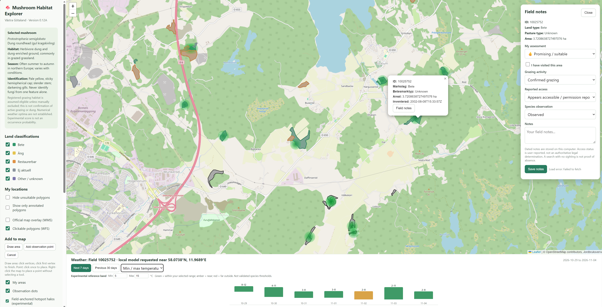

# Shroomap

**GIS-based mushroom habitat exploration and weather-informed field prioritization**

Shroomap is a personal software project that combines public geospatial datasets, forecast and historical weather-model data, and user-recorded field observations in an interactive map. Its purpose is to help identify and compare candidate habitats for field surveys, while making the assumptions and uncertainties behind its environmental rankings visible.

The initial prototype focuses on *Protostropharia semiglobata* (dung roundhead; Swedish: gul kragskivling), a fungus associated with dung and dung-enriched grassland. The architecture is intended to support additional species profiles and more robust, evidence-based prioritization over time.

**Project status:** Experimental local prototype; documented application version: **v0.15**. The initial GitHub checkpoint is v0.14.2. A habitat-priority feature is prepared for v0.16 but is not part of this documented version. The fruiting-weather index is an exploratory heuristic, not a validated species-distribution model or a probability of finding mushrooms.



## Features

- **Interactive geographic exploration:** Leaflet map with OpenStreetMap basemap and Swedish agricultural habitat data.
- **Official habitat polygons:** Retrieves mapped meadow and pasture inventories from the Swedish Board of Agriculture (Jordbruksverket) through WFS, with an optional WMS layer for visual context.
- **Field-centred environmental estimates:** Requests weather data near each candidate field, rather than using a single regional score for every field. Displays requested coordinates and the location returned by the weather provider.
- **Species fruiting-weather index:** Computes a provisional 0–100 index using shallow soil moisture, recent moisture history and minimum/maximum temperatures, with experimental adjustments for rainfall history, cooling and freezing conditions.
- **Search-area visualization:** Displays green halos around qualifying pasture candidates when the local environmental index exceeds a user-selected threshold. Habitat eligibility and environmental conditions are separate decisions.
- **Weather context:** Displays recent history and a seven-day forecast, including precipitation, temperature, humidity, wind, reference evapotranspiration and modelled soil moisture where available. Diagnostics include recent rainfall totals, cooling, frost indicators and scoring modifiers.
- **Field annotations:** Saves field visits, grazing assessments, suitability judgments and notes.
- **User-defined areas and observations:** Supports custom mapped areas and point observations with species, date, confidence and notes.
- **Persistent local data:** Stores user annotations and observations in SQLite.

## Purpose and approach

Shroomap addresses a practical field-survey question: **given multiple candidate locations in an area, which should be inspected first?**

The application combines two distinct sources of information:

1. **Habitat evidence:** A mapped land parcel may be a plausible habitat because of its land-use classification or the user's observations. In the current profile, registered grazing pasture is treated as a candidate; restoration-status or otherwise excluded land is not automatically recommended. Registration does **not** establish current grazing, dung presence, access rights or fungal occurrence.
2. **Environmental conditions:** Temperature and moisture may affect fungal activity and fruiting. Weather-model estimates can help compare current conditions across candidate locations but do not measure the actual microclimate or substrate conditions within a field.

A halo is produced only when the mapped habitat passes the application's eligibility rules **and** its local weather-related index meets the selected threshold. The absence of a halo is not evidence that the species is absent.

## Data sources

| Source | Data | Use and limitations |
| --- | --- | --- |
| [Jordbruksverket](https://jordbruksverket.se/) | Meadow and pasture inventory, accessed through [WFS](https://epub.sjv.se/inspire/opendata/wfs) and [WMS](https://epub.sjv.se/inspire/opendata/wms) | Official mapped habitat boundaries and attributes. Inventories may be historical, overlapping or incomplete; classifications do not necessarily describe present-day grazing. |
| [Open-Meteo](https://open-meteo.com/) | Historical model estimates and forecasts, including daily meteorology and hourly modelled soil moisture | Spatially gridded estimates, not on-site measurements. Model resolution, grid-cell assignment, soil representation and forecast uncertainty can produce differences between nearby locations. |
| [OpenStreetMap](https://www.openstreetmap.org/) | Map tiles | Geographic basemap; attribution and tile-service usage conditions apply. |
| User observations | Field notes, area boundaries, point observations | Locally stored evidence that can improve assessments; not automatically verified. |

Shroomap's use of external services requires an internet connection. Availability and terms of upstream APIs and tile services may change. Third-party data and map content retain their respective licensing and attribution requirements.

## Species fruiting-weather index (v0.15)

The current index uses weather values for the requested field location, with nearby request coordinates cached at approximately 0.01° precision. This **request spacing is not a claim of kilometre-scale source-model accuracy**: Open-Meteo may resolve several requested positions to shared or different numerical model grid cells.

Open-Meteo's hourly volumetric soil-water content (m³/m³) for 0–7 cm and 7–28 cm depths is aggregated to daily arithmetic means. The shallow 0–7 cm series is used for the current experimental scoring formula. The score uses:

| Component | Weight | Current treatment |
| --- | ---: | --- |
| Current shallow soil moisture | 50% | Provisional asymmetric response; strongly penalizes low moisture but treats high moisture more conservatively because soil texture and field capacity are unknown. |
| Seven-day shallow moisture mean | 20% | Indicates persistence of estimated moisture conditions. |
| Daily minimum and maximum temperature | 30% total | Smooth, provisional temperature-response curves evaluated separately. |

The components yield a baseline index from 0 to 100. v0.15 extends that baseline with **provisional, bounded weather-history modifiers**. The model examines recent rainfall over 3-day and 14-day windows, a cooling trend relative to the preceding week, and recent frost or persistent freezing. The modifiers are conditional: for many ordinary weather scenarios they equal 1.0 and have no effect. Rainfall is not independently added as a second soil-moisture measurement; excessive weighting would risk counting related moisture effects twice.

Seasonal context is described in the species profile, but the current numerical seasonal multiplier is **neutral**. A documented fruiting period from a different region does not justify imposing strict Swedish calendar cutoffs. One frost event does not permanently terminate the season in this model.

Missing essential measurements produce an unavailable score rather than an automatically favourable assessment. The weather panel exposes the measured/modelled inputs, baseline component scores, weather-history adjustments and resulting index.

**The response functions, weighting, numerical centres and weather-history adjustment factors are engineering hypotheses, not experimentally established optima for *P. semiglobata*.** In particular, volumetric soil moisture cannot be interpreted as a universal percentage of field capacity without soil-specific information. Values such as 70 or 95 on the index are not percentages of occurrence probability, and there is no demonstrated calibration against observed fungal fruiting events.

### Spatial and temporal uncertainty

- Adjacent fields can receive different modelled moisture values because of model grid selection, elevation, soil parameterization or genuine weather differences. Similar recent rainfall does not ensure identical modelled soil moisture.
- Weather-model estimates do not resolve within-field drainage, dung substrate, vegetation, shade, fine-scale topography or land management.
- The current habitat filter is primarily categorical; it does not infer actual dung abundance, cattle presence or legal access.
- Forecast suitability is exploratory. Rainfall, cooling and frost effects are provisional rather than estimates from a fitted species response model. No quantitative forecast skill has been validated against mushroom records.

## Technology and architecture

- **Backend:** Python, Flask and Requests.
- **Spatial processing:** Shapely for geometry handling and overlap deduplication of near-identical official inventory polygons.
- **Frontend:** HTML, CSS and JavaScript rendered by Flask, with Leaflet for the interactive map.
- **Persistence:** SQLite database for user-created areas, observations and field assessments.
- **External interfaces:** Jordbruksverket WFS/WMS and Open-Meteo forecast API.

The application is currently implemented primarily in `app.py` as a compact prototype. Weather requests use in-memory caching and bounded concurrent fetching to reduce redundant provider calls. This is not yet a production deployment architecture.

## Installation

Python 3.10 or newer is recommended for the project environment. Git and internet access are useful for cloning the source and retrieving the external data.

```bash
git clone https://github.com/malstrom82/shroomap.git
cd shroomap
python -m venv .venv
```

Activate the virtual environment:

**Windows PowerShell:**

```powershell
.\.venv\Scripts\Activate.ps1
```

**macOS/Linux:**

```bash
source .venv/bin/activate
```

Install dependencies and start the local Flask application:

```bash
python -m pip install -r requirements.txt
python app.py
```

Open **http://127.0.0.1:5000** in a browser. The application creates its local SQLite database when required. Initial map and weather content depend on the availability of external services.

If PowerShell blocks environment activation, use `.\.venv\Scripts\python.exe` explicitly for `pip` and `app.py` commands instead of changing the system's execution policy.

## Typical workflow

1. Navigate to a region and examine official pasture inventory polygons and the associated environmental halos.
2. Adjust the experimental threshold to compare candidate sites under the current model.
3. Select a field to inspect land classification, requested/model weather coordinates, moisture, temperatures and score components.
4. Record evidence of grazing, field condition or observed mushrooms and update the field assessment.
5. Compare candidates. Treat rankings as leads for a field survey, not definitive presence/absence predictions.

## Data privacy and repository hygiene

The SQLite database `field_notes.sqlite3` contains local user records and may include precise observation coordinates. It is intentionally excluded from version control. Python virtual environments, generated files, local credentials and caches should also remain untracked.

For a new installation, the application will initialize its own database; sample observation data are not supplied by default. Do not publish private observations, access credentials or coordinates without reviewing them first.

## Roadmap

- Evaluate and calibrate the preliminary species fruiting-weather profile introduced in v0.15 against documented observations and independent ecological evidence.
- Develop habitat-based search-priority categories using pasture status, field notes and grazing evidence (prototype prepared for v0.16; not yet covered by this README).
- Compare weather-model outputs and, where supported by accessible data, incorporate soil and terrain context without claiming field-scale measurement precision.
- Develop repeatable tests for scoring, geometry and API-failure behaviour; separate backend, frontend and modelling modules.
- Evaluate candidate-site rankings against accumulated field observations and revise the model based on actual predictive performance.
- Prepare for optional hosted deployment with API rate limits, persistent storage, configuration management and appropriate service terms.

## Development status and limitations

Shroomap is an independently developed personal project intended for learning and experimentation with geospatial data, interactive visualization, environmental modelling and human-centred decision support. It is **not** a peer-reviewed biological prediction system, a field identification guide or a guarantee of edibility, species presence or safe access to land.

The initial repository commit captures the **v0.14.2 checkpoint**; this document describes **v0.15**. Later development, including the prepared v0.16 habitat-priority prototype, is tracked separately. See [CHANGELOG.md](CHANGELOG.md) for version history and release status.

## Development history

See [CHANGELOG.md](CHANGELOG.md) for documented checkpoints, changes and the status of the next development version.

## Licensing and attribution

No software license has been selected for this repository yet. Until a license is added, the source code should not be assumed to be licensed for unrestricted reuse. Third-party data, map tiles and software packages are governed by their own terms and licenses. Add an appropriate project license once the intended reuse permissions are decided.
